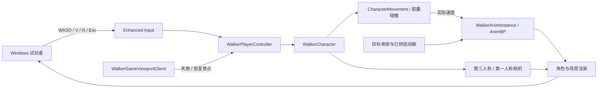
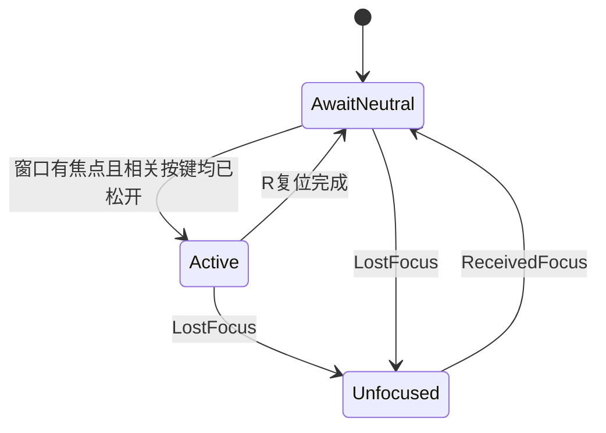

# Walker · Windows 技术设计

版本：1.1（设计稿）

作者：Codex  
日期：2026-11-16  
适用范围：第一阶段 3D 行走交互小样  
验证状态：已核对文档和官方技术资料；尚未创建 UE 工程，未执行编译、打包或 Windows 体验验收。

## 1. 目录

<!-- toc:start -->
- [2. 问题与背景](#2-问题与背景)
- [3. 设计目标](#3-设计目标)
  - [3.1 功能与范围](#31-功能与范围)
  - [3.2 性能与可复现性](#32-性能与可复现性)
  - [3.3 约束与风险](#33-约束与风险)
- [4. 整体架构](#4-整体架构)
  - [4.1 技术选型](#41-技术选型)
  - [4.2 系统上下文与组件](#42-系统上下文与组件)
  - [4.3 工程目录与资产管理](#43-工程目录与资产管理)
- [5. 详细设计](#5-详细设计)
  - [5.1 模型与协议](#51-模型与协议)
  - [5.2 流程设计](#52-流程设计)
  - [5.3 关键算法与实现约束](#53-关键算法与实现约束)
  - [5.4 Windows 开发、打包与试玩](#54-windows-开发打包与试玩)
  - [5.5 验证设计](#55-验证设计)
- [6. 任务分解](#6-任务分解)
- [7. 修订与参考](#7-修订与参考)
  - [7.1 修订历史](#71-修订历史)
  - [7.2 参考资料](#72-参考资料)
<!-- toc:end -->

## 2. 问题与背景

[第一阶段目标](phase-1.md)要求展示成年女性角色穿高跟鞋行走，通过 WASD 前进、后退和侧移，并用 V 切换第一、第三人称。当前仓库只有说明文档，工程、角色和动画尚未落地。

用户已明确最终运行在 Windows，并倾向虚幻 5。本设计以 **UE 5.8.4 + Windows 11 x64 原生程序**为主方案；工程创建、角色调试、编译、打包和体验验收均在 Windows 上完成。不设置 macOS 运行适配、跨平台导出或本机试玩任务。

本阶段最需要验证的是目标角色体态、高跟鞋支撑姿态与多方向步态能否同时成立。引擎具备重定向和动画混合能力，不代表普通平底鞋动画可以直接达到效果要求。

主要使用者是试玩者和后续开发者：前者需要直接解压运行、观察动作并反馈问题；后者需要可复现的工具链、清晰的资源要求和可核对的验收记录。

## 3. 设计目标

### 3.1 功能与范围

| 内容 | 本阶段设计 |
| --- | --- |
| 交付 | 单机、离线、Windows x64 桌面程序，一个平坦展示场景 |
| 角色 | 一名成年女性，体态与高跟鞋符合阶段目标，固定一套服装 |
| 移动 | WASD；角色局部方向；A/D 平移、S 后退，保持朝向 |
| 组合输入 | 相反键相消；四个斜向与单向具有相同目标总速度 |
| 动画 | 站立、四个基本方向、四个斜向及起停衔接；手臂、髋部随步态协调 |
| 相机 | 默认全身第三人称，V 瞬时切换到稳定第一人称，再按返回 |
| 生命周期 | 失焦停止并清除输入；R 复位；Esc 退出；重新启动恢复初始状态 |

本版沿用固定角色朝向，不增加鼠标环视和转向操作。第一人称隐藏整个人物及其服装、鞋和头发，保持无遮挡视线；切回第三人称恢复显示。以上是本设计采用的第一阶段默认交互选择，后续如需改变，应同步修改目标和验收项。

不安排关卡、跑跳、联网、账号、存档、布料模拟、面部表情或身体软组织物理。角色体态通过模型和蒙皮表现。场景保留足够行走空间和简单碰撞边界，不添加玩法障碍。

### 3.2 性能与可复现性

- 性能设计目标：选定 Windows 试验机上，1920×1080、100% 渲染比例、基线画质，预热后连续运行 3 分钟，平均帧率不低于 60 FPS，P95 帧耗时不高于 20 ms。该指标尚未实测，也不是对任意 Windows 设备的保证。
- W1 记录试验机 CPU、GPU、显存、内存、Windows 版本、驱动、引擎完整版本、画质和 RHI；最终最低配置由实测形成。
- 正常起停在 0.25 秒内完成主要速度变化；失焦和复位立即停下，不延续惯性。
- 同一场景在 30、60、120 FPS 限制下运行，稳态移动距离差异不超过 5%；低于目标帧率的限帧检查只验证时间一致性。
- 场景、蓝图、资源和配置随工程交付；打包程序在未安装 UE 编辑器的 Windows 试验环境中可启动。

### 3.3 约束与风险

| 风险 | 处理方式与关口 |
| --- | --- |
| 角色资源或授权不满足要求 | W1 确认候选资源、修改权限、分发许可与获取方式；未确认前使用明确标注的占位资源 |
| 平底鞋动作重定向后姿态失真 | W1 使用真实鞋型和候选体态验证；必要时修动作或制作高跟鞋专用片段 |
| 四方向混合产生斜向交叉腿或滑步 | W1 检查全部斜向；不能达标时补四个斜向片段，不降低验收范围 |
| UE 编辑器对设备要求高 | 区分开发机与程序运行机；先打包空场景验证工具链，再投入美术资源 |
| 蓝图和场景属于二进制资产 | 明确资产负责者，避免多人同时改同一资产；运行逻辑保留为少量可审查的 C++ |

## 4. 整体架构

### 4.1 技术选型

| 层次 | 选型 | 理由与边界 |
| --- | --- | --- |
| 引擎 | Epic Games Launcher 安装的 UE 5.8.4 正式补丁版 | 采用已发布版本，不依赖 Preview 或引擎源码修改；W1 记录完整 Build/Changelist [R1] |
| 工程 | 一个 `Walker` C++ 游戏模块 + 蓝图资产 | C++ 负责移动、相机、输入和复位；蓝图负责资源引用、动画图和场景装配 |
| 移动碰撞 | `ACharacter` + `UCharacterMovementComponent` + 胶囊体 | 使用引擎行走、重力和地面碰撞，不手动按帧平移角色 |
| 输入 | Enhanced Input | 独立动作映射，明确组合键累加与按下沿行为 [R4] |
| 动画 | Skeletal Mesh、Animation Blueprint、2D Blend Space | 原地循环动画与实际移动速度关联；不采用 Motion Matching 或完整大型角色框架 |
| 资源适配 | 编辑期 IK Rig / IK Retargeter；需要时使用 Control Rig 修片并烘焙 | 运行时直接播放目标骨架片段，减少运行时依赖 [R6] |
| 渲染 | DirectX 11 / SM5、常规桌面延迟渲染、TAA、普通 Shadow Maps | 平坦小场景先建立稳定基线；显式关闭 Lumen、Nanite、硬件光追和 Virtual Shadow Maps [R3] |
| 相机 | 角色上的 ThirdPersonCamera、SpringArm、FirstPersonCamera | 两个 CameraComponent 只激活一个；无需额外相机插件 |
| 依赖 | 引擎模块及内置插件 | 不引入 Marketplace 运行时插件；美术源文件可由支持 FBX 的 Windows 工具制作 |

选择 UE5 的依据是其角色动画、重定向和可视化调试流程适合本项目；代价是编辑器、安装体积和构建环境较重。第一阶段的画面质量主要取决于模型、动画、材质和灯光，不以启用全部高级渲染功能作为完成标准。

### 4.2 系统上下文与组件



| 组件 | 责任 |
| --- | --- |
| `AWalkerGameMode` / `BP_WalkerGameMode` | 指定 Controller、Character 和出生点；加载唯一展示地图 |
| `AWalkerPlayerController` | 安装/移除输入映射；接收相机切换、复位、退出；管理焦点输入门禁 |
| `AWalkerCharacter` / `BP_WalkerCharacter` | 胶囊、移动参数、角色资源引用、两套相机、可见性与复位 |
| `UWalkerAnimInstance` / `ABP_Walker` | 从角色读取实际局部速度；管理 Idle/Locomotion 状态和步态参数 |
| `UWalkerGameViewportClient` | 覆盖 `LostFocus` / `ReceivedFocus`，先维护输入门禁并调用引擎父类逻辑，再通知 Controller [R5] |
| `L_WalkLab` | 平面、尺度参照、光照、出生点、碰撞边界；Game Default Map 与 Editor Startup Map 均指向此地图 |

实施 W3 时，在 `Config/DefaultEngine.ini` 中注册自定义 ViewportClient；仅定义 C++ 派生类不会自动替换引擎默认类 [R5]：

```ini
[/Script/Engine.Engine]
GameViewportClientClassName=/Script/Walker.WalkerGameViewportClient
```

完成编译和配置后重启编辑器，并重新打包 Development 程序。启动时检查实际 `GameViewport` 对象的类型，记录类路径，确认使用 `UWalkerGameViewportClient`；再验证失焦与恢复焦点确实进入该类回调。将类路径与焦点事件记录纳入 W3 验证证据，不能仅以配置文件存在或 PIE 中行为正常判定生效。Shipping 包沿用该注册配置，并重跑焦点行为验收。

### 4.3 工程目录与资产管理

以下是实施时创建的目录，不代表当前已有文件：

```text
games/walker/
├── Walker.uproject
├── Config/                       # 默认地图、输入、渲染、打包配置
├── Source/Walker/                # 单一 C++ 游戏模块
├── Content/Walker/
│   ├── Blueprints/               # BP_WalkerCharacter 等装配资产
│   ├── Input/                    # IA_Move、IA_ToggleView、IMC_Walker 等
│   ├── Characters/               # 骨架、网格、服装、高跟鞋及材质
│   ├── Animations/               # 片段、Blend Space、AnimBP、重定向资产
│   └── Maps/                     # L_WalkLab
├── SourceAssets/                 # 可提交的模型/动作源文件及制作说明
├── docs/
│   ├── phase-1.md
│   ├── technical-design.md
│   └── validation/               # W1 起创建设备与验收记录
└── README.md
```

保留 `.uproject`、`.uasset`、`.umap`、`Config/Default*.ini`、源码、源素材及来源说明。沿用根目录对 `DerivedDataCache/`、`Intermediate/`、`Saved/` 的忽略规则；初始化时增加本游戏的 `Binaries/`、构建输出和生成解决方案忽略项。此时不创建空工程目录或启用 Git LFS；拿到实际资产大小后再评估。

## 5. 详细设计

### 5.1 模型与协议

#### 5.1.1 内部状态与配置

本项目没有网络 API、数据库或存档协议，以下为模块内约定。

| 数据 | 含义 / 初值 |
| --- | --- |
| `ViewMode` | `ThirdPerson` 或 `FirstPerson`；初值 `ThirdPerson` |
| `InputState` | `Active`、`Unfocused`、`AwaitNeutral`；初始化和重新获得焦点后等待输入中立 |
| `MoveInput` | 二维向量，X 为右、Y 为前，长度上限 1 |
| `LocalVelocity` | 角色实际速度在角色坐标系中的投影，单位 cm/s |
| `MaxWalkSpeed` | 调参初值 120 cm/s；W1 根据目标动画标定，不作为已验证速度 |
| `MaxAcceleration` | 调参初值 800 cm/s²；`BrakingDecelerationWalking` 初值 1000 cm/s² |
| `SpawnTransform` | 启动时保存的出生位置和固定朝向，供复位使用 |
| `EyeHeight` / 第三人称参数 | 由角色真实尺寸标定，保存在角色蓝图默认值，不写死在算法中 |
| `ReferenceSpeed` | 目标步态在 1 倍播放速度下的标定移速；片段制作说明中记录 |

常量集中放在角色/Controller 默认属性中，不增加配置中心或通用框架。动画蓝图只消费运动状态，不写入胶囊位置或角色朝向。

#### 5.1.2 输入契约

| 动作 | 绑定 | 行为 |
| --- | --- | --- |
| `IA_Move`（Axis2D） | W=(0,+1)、S=(0,-1)、A=(-1,0)、D=(+1,0) | 使用键映射的 Negate / Swizzle；`AccumulationBehavior=Cumulative`，相反方向相消；结果再限幅到单位圆 [R4] |
| `IA_ToggleView`（Bool） | V | 使用 Pressed 触发器的 `Triggered` 事件，仅在越过按下阈值时切换一次，不使用持续按住的触发方式 |
| `IA_Reset`（Bool） | R | 一次按下执行完整复位 |
| `IA_Quit`（Bool） | Esc | 独立程序正常退出；编辑器中不承担关闭编辑器的行为 |

输入上下文只安装一次，在退出或 Controller 结束时移除；同时处理动作的 Completed / Canceled，避免仅记录按下而未清零。输入刷新可能引发动作回调，因此失焦时先关闭动作接受门禁，再清理按键状态。

#### 5.1.3 角色与动画资源契约

- 单位以厘米为准，场景中 100 cm 为 1 m；角色逻辑朝前为 +X，向右为 +Y，向上为 +Z。导入网格的骨架轴差异通过资源导入和 Mesh 相对旋转处理。
- 候选角色必须具有可用的骨盆、脊柱、头、左右手臂、上下腿、脚及脚趾骨骼；服装与鞋使用同一目标骨架或可靠的跟随绑定。W1 检查身体比例、肩髋蒙皮、膝盖弯曲方向和鞋内脚形。
- 高跟鞋是角色姿态的一部分：记录鞋跟尖和前掌接触点、足部骨骼到鞋底的偏移；静止时鞋跟尖与前掌接近地面，行走摆动相不要求两者同时接地。不能把足骨或脚踝直接吸附到地面。
- 角色最终外观资源尚未选定；技术选型不默认使用 MetaHuman，不默认免费角色一定满足体态或修改许可。W1 在候选资源表中记录来源、作者、许可、可修改性和获取步骤。
- 基础动作至少为 Idle、Forward、Backward、StrafeLeft、StrafeRight。斜向按混合结果验收；预算和排期预留 ForwardLeft、ForwardRight、BackwardLeft、BackwardRight 四个专用片段。
- 统一循环相位，例如左脚支撑开始；所有移动片段使用一致的 `LeftPlant` / `RightPlant` 标记。重定向后逐帧检查脚尖、鞋跟、膝盖和手臂穿插。
- 运行时使用目标骨架的原地动画，根不累计水平位移或朝向；如来源包含 Root Motion，在编辑期转换并保留来源。禁止同时由动画根运动与 CharacterMovement 驱动位移 [R8]。
- 外来动画先用 IK Retargeter 离线适配并导出目标片段；在目标体态与鞋型上修正踝部、膝盖、骨盆和摆臂，不能仅通过整体抬高角色修复穿地 [R6]。
- 每项发布资产保留来源和许可说明；许可不允许提交源文件时，记录授权获取与导入步骤，不将其直接放入仓库。占位和最终资产在说明中明确区分。

### 5.2 流程设计

#### 5.2.1 启动与每帧更新

1. 加载 `L_WalkLab`，创建角色和 Controller；保存出生变换，设置固定朝向、第三人称和动画初始状态。
2. 安装 `IMC_Walker`，获得游戏窗口焦点；进入 `AwaitNeutral`，确认 WASD/V/R 均松开后进入 `Active`。
3. Enhanced Input 读取组合方向，Controller 检查输入门禁，角色提交移动意图。
4. CharacterMovement 按引擎时间推进位移和碰撞；动画在运动更新后读取实际速度，避免角色被边界挡住时仍全速走路。
5. AnimBP 更新步态，相机跟随胶囊的稳定基准；渲染当前视角。

#### 5.2.2 失焦与恢复



`LostFocus` 后立即禁止游戏动作、清除缓存和引擎按键状态、消费待处理移动输入并调用 `StopMovementImmediately`。角色回到静止动画状态，保持位置和当前视角；不强制暂停整个世界，也不依赖后台 Tick 才能停止。

`ReceivedFocus` 后不恢复旧输入，不自动调用行走。仅在自身窗口有焦点且处于 `AwaitNeutral` 时，用 Win32 `GetAsyncKeyState` 查询 W/A/S/D/V/R 的当前按下状态，使用返回值最高位，不使用不可靠的“自上次查询以来按过”最低位 [R12]。全部松开后再次清理输入缓存，下一帧进入 `Active`。该调用封装在 Controller 的 Windows 实现中，明确链接 `User32.lib`；不增加平台插件。

要验证“切回时仍按住 W/V”以及“在窗口外松开按键”的情况，不能只信任上次缓存的动作值。窗口尺寸变化导致的焦点变化也使用同一停止规则。焦点事件在窗口化独立程序中验收，不能用 PIE 的结果代替。

#### 5.2.3 视角切换与复位

V 只更新 `ViewMode`、CameraComponent 激活状态和角色可见性，不重建角色、不重播动画、不修改 Transform。

R 复位时依次关闭输入门禁、清空按键和移动意图、停止运动、恢复出生 Transform、重置动画为 Idle、恢复第三人称与角色可见性、清除相机滞后缓存，再等待按键松开。调用引擎提供的 Teleport/移动复位机制，不在碰撞解算中强制每帧写位置。运行过程中不创建额外角色、相机或重复输入绑定。

退出时释放本对象注册的事件、输入映射和定时任务。第一阶段不需要自建后台线程或循环计时器。

### 5.3 关键算法与实现约束

#### 5.3.1 移动与时间

```text
input = ClampLength(CumulativeWASD, 1)
if InputState != Active:
    input = (0, 0)

AddMovementInput(ActorForward, input.y)
AddMovementInput(ActorRight,   input.x)

# CharacterMovement 执行加速、制动、重力和碰撞
worldVelocity = CharacterMovement.Velocity
forwardSpeed = Dot(worldVelocity, ActorForward)
rightSpeed   = Dot(worldVelocity, ActorRight)
```

关闭 `bOrientRotationToMovement`、`bUseControllerDesiredRotation` 和角色的 `bUseControllerRotationYaw`，不绑定鼠标朝向输入。控制方向基于 Actor，独立于相机。

`AddMovementInput` 提交的是方向和比例，不是位移，不再额外乘 `DeltaSeconds`；时间推进由 CharacterMovement 完成 [R9]。自写的速度平滑、相机缓动和超时才显式使用时间增量。胶囊负责身体碰撞，脚和鞋不分别添加物理刚体。

正常松键通过制动停止；相反键等效于该轴无输入，角色按同样制动规则停止，不能瞬间反向弹跳。失焦、复位属于立即停止路径。

#### 5.3.2 动画混合、步频与接地

状态机采用 `Idle ↔ Locomotion`，使用低速阈值及少量滞回避免边界抖动，过渡初值 0.15 秒。在 Locomotion 内使用 2D Blend Space：把实际局部平面速度归一化为方向，横轴为右向分量，纵轴为前向分量，均限制在 [-1,1]。速度大小独立用于状态转换和播放速率；不再通过 Blend Space 轴长度重复缩小步幅。

接近零速时切回独立 Idle 状态，并保留最近一次有效方向，不向仅含移动片段的 Blend Space 输入 (0,0)，避免混合相反方向动作形成错误站姿。进入/离开 Locomotion 的速度阈值初值分别为 8 cm/s 和 3 cm/s，需结合加速、制动和过渡时长在 W1 调整。

| 样本方向 | Blend Space 坐标 |
| --- | --- |
| 前 / 后 | (0,+1) / (0,-1) |
| 左 / 右 | (-1,0) / (+1,0) |
| 左前 / 右前 | (-0.707,+0.707) / (+0.707,+0.707) |
| 左后 / 右后 | (-0.707,-0.707) / (+0.707,-0.707) |

斜向坐标与归一化移动方向一致，不把斜向动画放在 (±1,±1)。只有四个基向样本时，斜向输入可能落在样本凸包以外，不能假定引擎插值就能产生合格动作。W1 如果发现腿部交叉、脚向或支撑不自然，补相应斜向样本；目标坐标处必须有可用动作或经录像验证的混合结果。

步频按实际平面速度与 `ReferenceSpeed` 的比例校准。片段先统一步长和循环时长，再小范围调 Play Rate；不能靠极端加减速弥补不匹配的动作。起步和停止由实际速度驱动混合，避免输入已经松开但胶囊仍制动时动画先完全站住。移动循环通过 Sync Group 与相同脚落地标记保持相位 [R7]。

平坦地面的默认方案是正确制作/重定向的动作加正确的角色高度，不引入运行时全身 IK。如果修片后仍有局部接地误差，再在 W1 明确启用最小 Control Rig 足部修正：按鞋跟/前掌接触偏移计算目标，按落脚曲线限定支撑相和权重，限制足部、膝盖和骨盆的修正幅度。IK 不能锁住摆动脚，也不能让鞋跟和前掌在整个行走周期同时贴地。启用后需重新执行全部方向和起停验收。

#### 5.3.3 相机与角色显示

- 第三人称：SpringArm 连接胶囊上的稳定支点，不连接骨盆或头骨；后距调参初值 350 cm，支点高约 110 cm，FOV 初值 65°。按最终角色尺寸、窗口纵横比调整距离和俯角，验收时全身与鞋跟均在画面内。
- 保留 SpringArm 碰撞检测，避免镜头穿入遮挡物；先关闭相机滞后，验收稳定后再评估是否有必要加入。SpringArm 遇到遮挡会回缩，可能破坏全身构图，因此通过场景缓冲布局保证正常可行走区域内的镜头空间 [R13]。
- 角色可行走边界与外侧围栏/墙体分离：内侧碰撞边界阻挡 Pawn、忽略 Camera；外侧实体保留 Camera 阻挡。两者间预留覆盖最终相机最大水平后距、探测球半径及安全余量的缓冲距离，地面覆盖该空间。缓冲值按最终角色尺寸、相机俯角和窗口纵横比标定，记录在 W2/W5 验收中。
- 在四边和四个角落验证第三人称构图，并在这些位置从第一人称切回第三人称；全身与鞋跟仍需可见。若正常行走范围内发生回缩裁切，调整缓冲距离、遮挡物布局或构图参数后重新验收。
- 第一人称：位于胶囊上的标定眼高，朝向与 Actor 一致，不继承步态头骨的上下晃动；只保留稳定平视镜头。
- V 使用瞬时切换，不做穿过后脑的镜头插值。切换后正确激活唯一相机，并恢复相应的角色及附属 Mesh 可见性。
- 第一人称隐藏人物时，角色 Mesh 仍使用 `AlwaysTickPoseAndRefreshBones` 持续更新动画和骨骼，避免切回时恢复旧姿态；单角色场景接受该开销 [R10]。
- 窗口缩放、最小化和恢复后重新检查纵横比与全身构图，不把脚部裁出画面；不绑定鼠标捕获或光标锁定。

#### 5.3.4 场景、灯光与性能

建立约 30 m × 30 m 的平面和明显尺度线，按 5.3.3 分开设置内侧角色碰撞边界与外侧围栏/低墙，预留相机缓冲空间，保证镜头可用。可行走区域内保留至少 15 m 的无阻挡直线测试路线，按最终标定速度确认足以覆盖加速和 10 秒稳态行走；必要时扩大地面以同时满足路线与相机空间要求。使用一个主要光源、环境补光和接地阴影；固定曝光，方便比较脚部与地面的关系。角色头发优先使用常规发片，材质先使用常规骨骼网格材质，不启用 Groom 或实时布料。

基线显式设置 DirectX 11、SM5、普通 Shadow Maps；关闭动态全局光照 Lumen、Lumen 反射、硬件光追、Nanite 和 Virtual Shadow Maps。该选择是本项目减少渲染变量的方案，并不声称所有 DX11 配置都不能使用软件 Lumen [R3]。渲染升级需基于 Windows 实测，不在第一阶段并行维护两套画质方案。

每帧只处理一个角色和常量数量的输入/动画参数，复杂度为 O(1)。不扫描场景获取角色，不在 Tick 创建对象或反复加载资源；用明确的资源引用确保打包烘焙能找到目标角色、动画和地图。

### 5.4 Windows 开发、打包与试玩

#### 5.4.1 环境基线

| 项目 | 设计基线 |
| --- | --- |
| 开发系统 | Windows 11 x64，显卡厂商正式驱动 |
| 引擎 | UE 5.8.4，Launcher 二进制安装，包含 Windows 目标组件 |
| IDE / 编译器 | Visual Studio 2022 17.14、MSVC v143 14.44.35207、Windows SDK 10.0.22621.0；安装“使用 C++ 的游戏开发”工作负载，按 UE 工具链检查补齐组件 [R2] |
| 开发机参考 | 32 GB RAM、8 GB 或以上显存、SSD；这是参考开发配置，不是游戏最低运行配置 [R2] |
| 程序运行机 | Windows 11 x64、支持本项目 DX11/SM5 的 GPU；其余最低配置待 W1 与实际打包程序确认 |
| 启动方式 | 开发者打开 `Walker.uproject`；试玩者解压完整 Windows 构建目录并运行启动 exe |

工具链组合取自 UE 5.8 官方发行资料中的构建基线，是本项目的固定选择，不是引擎支持的唯一组合。W1 保存实际安装版本与编译输出；如果工具链检测要求调整，同步更新此表和验收记录，不静默混用版本。

#### 5.4.2 实施后的命令约定

以下是未来工程建立后的 PowerShell 命令约定，**当前没有 `Walker.uproject`，不得将其视为已执行或现在可运行的命令**。`EngineRoot` 和 `ProjectPath` 按 Windows 实际路径调整。

```powershell
$EngineRoot = 'C:\Program Files\Epic Games\UE_5.8'
$ProjectPath = 'D:\projects\amazing-projects\games\walker\Walker.uproject'
$ArchiveRoot = 'D:\walker-builds\phase-1-development'

& "$EngineRoot\Engine\Build\BatchFiles\Build.bat" WalkerEditor Win64 Development $ProjectPath -WaitMutex -NoHotReloadFromIDE
if ($LASTEXITCODE -ne 0) { throw 'WalkerEditor 编译失败' }

& "$EngineRoot\Engine\Build\BatchFiles\RunUAT.bat" BuildCookRun "-project=$ProjectPath" -noP4 -platform=Win64 -clientconfig=Development -build -cook -map=/Game/Walker/Maps/L_WalkLab -stage -pak -package -archive "-archivedirectory=$ArchiveRoot" -prereqs -utf8output
if ($LASTEXITCODE -ne 0) { throw 'Windows 打包失败' }
```

项目设置中明确指定 Game Default Map、要打包的地图、Win64 目标和先决运行库安装项。以 Development 构建进行日志与性能检查，再用同一配置资源生成 Shipping 构建并重跑主要体验项；切换构建类型后不能沿用“已验收”的结论 [R11]。

#### 5.4.3 交付与记录

交付打包工具输出的**完整 Windows 目录**，包含启动 exe、游戏内容、引擎依赖及先决运行库安装程序，不只发送单个 exe。试玩机不需要 UE 编辑器和开发用 Visual Studio；首次运行按包内说明安装所需运行库。

随包附简短中文说明，记录构建标识、UE 完整版本、工具链、目标地图、渲染配置、操作键、已知限制和问题反馈格式。Development 包收集游戏 `Saved/Logs/` 下日志；无法写入安装目录时同时检查 `%LOCALAPPDATA%\Walker\Saved\Logs`，具体位置在 W1 包上确认并写入 README。崩溃另保留 `Saved/Crashes` 和复现步骤；Shipping 不以控制台或完整日志可用作为操作前提。

`docs/validation/` 保存设备表、验收结果和录像索引。大录像与打包产物不提交 Git，记录稳定存放位置、文件名和构建对应关系；不存在素材或构建时不伪造校验值。

### 5.5 验证设计

| 范围 | 方法与证据 | 对应目标 |
| --- | --- | --- |
| 角色和接地 | Windows 第三人称录像与近景；站立、四向、四斜向、换向、起停逐项检查鞋跟/前掌、摆臂和穿插 | A1、A4 |
| 输入 | 四方向、四斜向、相反键、三键/四键组合；原地与边界阻挡时检查动画是否匹配实际速度 | A2、A3、A4 |
| 时间一致性 | 沿足够长且至少 15 m 的无阻挡直线路线，在 30/60/120 FPS 下经过加速段后持续行走 10 秒；发生边界碰撞的样本作废；稳态距离误差不超过 5% | A3、A9 |
| 相机 | 静止及行走中独立按 V、长按 V 2 秒、连续切换 20 次；位置/朝向不重置，返回时动画连续；移动到四边和四个角落，并在这些位置从第一人称切回第三人称，检查全身/鞋跟构图与镜头碰撞，记录缓冲距离和相机参数 | A5、A6、A7 |
| 失焦 | Development 独立包先记录实际 ViewportClient 类路径，确认自定义类及焦点回调生效；Development/Shipping 均测试按住 W/V 时 Alt+Tab、在窗口外松键、切回时仍按住、最小化和恢复，不得残留行走或意外切镜头 | A8 |
| 生命周期 | R 复位 10 次、退出再启动、窗口缩放；没有重复角色/绑定，始终恢复第三人称初始状态 | A10 |
| 性能 | Development 包预热 30 秒后采样 3 分钟；按 3.2 记录均值/P95，保留 `stat unit` / Unreal Insights 采样证据 | A9 |
| 可分发性 | 从无 UE 编辑器的 Windows 环境启动完整包；安装先决库后复测；Shipping 再跑 A1—A10 | A9、A10 |

后续实施只为关键行为增加必要的 UE 自动化检查，例如输入组合相消/限幅、视角切换与复位状态；动画自然度、模型穿插和打包可玩性必须实际观察。当前仅有文档，不为此安装测试框架，也不声称检查已通过。

## 6. 任务分解

| 任务 | 依赖 | 工作与交付 | 完成条件 |
| --- | --- | --- | --- |
| W1a · Windows 工程与工具链 | 本设计 | 创建 UE C++ 工程、固定版本与 RHI；建立空地图并打 Development 包；记录环境 | 独立 Windows 包可启动，源码可重复编译；不以 PIE 代替打包 |
| W1b · 角色与步态验证 | W1a、合法候选资源 | 导入目标角色/鞋；试验四基向与四斜向、标定高度与速度；必要时修片/补斜向；记录资源与授权 | 所有方向的适配路径得到录像证明；冻结资源集合、是否启用足部修正及初步性能数据 |
| W2 · 场景与角色装配 | W1a、W1b | 完整平面、光照、参照物、内侧角色边界、外侧围栏及相机缓冲区、角色蓝图 | 站立体态、接地、构图符合 A1；记录边界碰撞响应与相机缓冲布局 |
| W3 · 方向控制与生命周期 | W2 | 输入映射、CharacterMovement、自定义 ViewportClient 注册、失焦门禁、复位和退出 | Development 独立包证实自定义类与回调生效；A2、A3、A8、A10 的控制部分通过 |
| W4 · 动画集成 | W1b、W3 | 实际速度驱动、Blend Space、循环相位、起停和可选足部修正 | A4 覆盖四基向、四斜向、换向及边界阻挡 |
| W5 · 相机与显示 | W2、W3、W4 | 双相机、单次按键切换、第一人称隐藏与持续动画更新；标定相机缓冲距离 | A5—A7 通过，窗口缩放、四边/四角及第一人称切回时均保持全身与鞋跟可见 |
| W6 · Windows 集成验收 | W3—W5 | Development/Shipping 打包、试验机性能、无编辑器环境启动；更新 README 与验收记录 | A1—A10 有真实结果、运行步骤与已知限制 |

W1b 是美术投入的关口：如果目标体态和鞋型上的动作达不到要求，先更换或修正资源，不继续堆场景。W1a 的空场景可启动只证明工具链可用，不代表角色方案已通过。

工作可由同一开发者依次推进；若有美术协作，模型和动作适配在 W1b 明确由谁负责。获取付费资产、最终美术风格和试验机硬件仍待实际资源条件确定，不在当前设计中假设已购入或已具备。

## 7. 修订与参考

### 7.1 修订历史

| 版本 | 日期 | 作者 | 变更 |
| --- | --- | --- | --- |
| 1.0 | 2026-11-16 | Codex | 按 Windows 最终平台及用户提出的 UE5 方向建立第一阶段技术设计；所有运行验证待执行 |
| 1.1 | 2026-11-16 | Codex | 补充自定义 ViewportClient 注册与独立包验证、场景相机缓冲布局及边界视角验收；所有运行验证仍待执行 |

### 7.2 参考资料

以下官方资料于 2026-11-16 核对。Epic 在线文档可能默认切换到其他版本；实施时使用 5.8 版本内容，并以 W1 的 5.8.4 实际安装与打包结果为准。

- 项目需求：[第一阶段开发目标](phase-1.md)。
- R1：[UE 5.8.4 官方补丁公告](https://forums.unrealengine.com/t/5-8-4-hotfix-released/2842775)。
- R2：[UE 5.8 发行说明：Platform SDK Upgrades](https://dev.epicgames.com/documentation/unreal-engine/unreal-engine-5-8-release-notes?lang=en-US)、[Visual Studio 环境设置](https://dev.epicgames.com/documentation/en-us/unreal-engine/setting-up-visual-studio-development-environment-for-cplusplus-projects-in-unreal-engine)、[硬件与软件规格](https://dev.epicgames.com/documentation/en-us/unreal-engine/hardware-and-software-specifications-for-unreal-engine)。
- R3：[桌面渲染路径支持情况](https://dev.epicgames.com/documentation/unreal-engine/supported-features-by-rendering-path-for-desktop-with-unreal-engine)。
- R4：[Enhanced Input](https://dev.epicgames.com/documentation/en-us/unreal-engine/enhanced-input-in-unreal-engine)、[输入累加策略](https://dev.epicgames.com/documentation/unreal-engine/API/Plugins/EnhancedInput/EInputActionAccumulationBehavior)。
- R5：[UGameViewportClient](https://dev.epicgames.com/documentation/unreal-engine/API/Runtime/Engine/UGameViewportClient?lang=en-US)、[UEngine 的 GameViewportClientClassName 配置](https://dev.epicgames.com/documentation/unreal-engine/API/Runtime/Engine/UEngine?lang=en-US)、[Enhanced Input 输入刷新行为](https://dev.epicgames.com/documentation/unreal-engine/API/Plugins/EnhancedInput/UEnhancedInputDeveloperSettings?lang=en-US)。
- R6：[IK Rig 动画重定向](https://dev.epicgames.com/documentation/en-us/unreal-engine/ik-rig-animation-retargeting-in-unreal-engine)。
- R7：[动画同步组与脚落地标记](https://dev.epicgames.com/documentation/en-us/unreal-engine/animation-sync-groups-in-unreal-engine)。
- R8：[Root Motion](https://dev.epicgames.com/documentation/unreal-engine/root-motion-in-unreal-engine?lang=en-US)。
- R9：[APawn::AddMovementInput](https://dev.epicgames.com/documentation/en-us/unreal-engine/API/Runtime/Engine/APawn/AddMovementInput)。
- R10：[骨骼网格可见性与动画 Tick 选项](https://dev.epicgames.com/documentation/unreal-engine/API/Runtime/Engine/EVisibilityBasedAnimTickOption?application_version=5.8)。
- R11：[工程打包流程](https://dev.epicgames.com/documentation/en-us/unreal-engine/packaging-your-project)。
- R12：[Microsoft Win32 GetAsyncKeyState](https://learn.microsoft.com/en-us/windows/win32/api/winuser/nf-winuser-getasynckeystate)。
- R13：[USpringArmComponent 碰撞回缩与探测参数](https://dev.epicgames.com/documentation/en-us/unreal-engine/API/Runtime/Engine/USpringArmComponent)。
